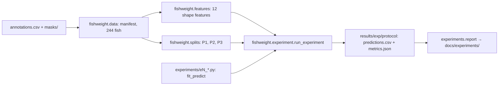

# Repository Guidelines

## Project Overview
Research project that estimates fish body weight in grams from a single photo. It started as a thesis (2023): U-Net segmentation → shape features → scikit-learn regressors. It is now being rebuilt in three phases: reproducible experiments, a web tool (FishWeight), and a paper.

- **Where the work stands:** `docs/ROADMAP.md`. Read it first.
- **What is being built and why:** `docs/superpowers/specs/2026-11-15-evolucao-fishweight-design.md`.
- **Current results:** `docs/experiments/relatorio-fase1a.md`.
- **Literature notes:** `docs/research/` (AI-generated; verify every citation at the source).

`README.md` holds only the thesis abstract. The full thesis is the root PDF. `ESTRUTURA.md` is an old, outdated restructuring plan.

## Architecture & Data Flow


- **Every experiment goes through `run_experiment`.** A script supplies `fit_predict(train, test) -> predictions`; the executor owns the folds, hides `weight` from the test rows, and writes the outputs. Don't write evaluation loops elsewhere.
- **Three protocols, fixed in `data/splits/*.json`:**
  - `p1`: the thesis's 70/30 split (74 test fish).
  - `p2`: 5-fold stratified by species group, 3 repeats.
  - `p3`: leave one collection session out (5 folds). **P3 with predicted masks picks the winning model.**
- **Reference-only runs** (`reference_only=True`) use information the tool won't have: annotated species, tape-measured length, or the thesis's leaky feature selection. They are never candidates.
- **Scale is preserved.** Photos come from a fixed camera (about 125 px/cm). Masks are reduced by an integer factor of 8, never stretched to a square. Any augmentation added later must not zoom or rescale.
- **Join key:** the image filename `IMG_YYYYMMDD_HHMMSS.jpg`. The date is the collection session.

## Key Directories
| Path | Purpose |
|---|---|
| `fishweight/data.py` | `load_manifest()`, `EXCLUDED_IMAGES`, `REPO_ROOT`, `DATA_DIR` |
| `fishweight/splits.py` | `build_splits`, `load_splits`, `PROTOCOLS`; `python -m fishweight.splits` rewrites `data/splits/` |
| `fishweight/features.py` | `load_mask`, `mask_features`, `FEATURE_NAMES`, `build_feature_table` (cache in `data/features/manual.csv`) |
| `fishweight/metrics.py` | `regression_metrics` (n, mae, rmse, mape, r2, bias), `bootstrap_ci`, `weight_band` |
| `fishweight/experiment.py` | `run_experiment`, `FitPredict` |
| `fishweight/allometric.py` | `AllometricRegressor` (`W = a·Areaᵇ`, optional per-species coefficients) |
| `fishweight/regressors.py` | `make_models()`: fresh instances of the thesis's seven regressors |
| `fishweight/commons.py`, `fishweight/segmentation/handcraft.py` | Inherited skimage utilities (classic segmentation) |
| `experiments/` | One script per experiment, plus `check_scale.py` and `report.py` |
| `results/` | Committed outputs: `<experiment>/<protocol>/{predictions.csv,metrics.json}`, `checks/escala.csv` |
| `data/coletas/combined/` | Dataset, **tracked in Git** even though `.gitignore` lists `data/coletas` (new files there are ignored): `images/`, `masks/`, `annotations.csv` (245 rows) |
| `docs/superpowers/plans/` | Implementation plans, one per roadmap row, with per-step checkboxes |
| `notebooks/`, root `commons.py` and `feature_extraction.py`, `handcraft_segmentation/`, `yolo_v8_instance_seg/`, `models/unet_model.h5` | **Frozen thesis record. Don't edit.** Legacy dependencies are in `notebooks/requirements-legado.txt` |

## Development Commands
Run everything from the repo root.
```bash
uv sync                                        # Python 3.12 environment
uv run pytest -q                               # full suite, about 5 s
uv run python -m experiments.e0_allometric     # rerun one experiment
uv run python -m experiments.e1_regionprops
uv run python -m experiments.check_scale
uv run python -m experiments.report            # regenerate tables in docs/experiments/
```
There is no linter, formatter or CI. Don't add tooling unless asked.

## Code Conventions & Common Patterns
- **Language:** identifiers are English snake_case. Docstrings, comments, error messages and printed output are **Portuguese**. Keep that split.
- Every module starts with `from __future__ import annotations` and uses type hints.
- **Style:** small modules of plain functions; the only class is `AllometricRegressor`. Configuration lives in module constants (`FEATURE_NAMES`, `WORK_SCALE`, `EXCLUDED_IMAGES`).
- **Paths** are built from `fishweight.data.REPO_ROOT`, never from the working directory.
- **Errors:** validate at the boundary and raise `ValueError` naming the file or fold. No silent row drops, no broad `except`.
- **Reproducibility:** `random_state=0` everywhere. Models are created fresh inside `fit_predict` for each fold.
- **No leakage:** any scaling, feature selection or tuning is fitted inside `fit_predict` on the training rows only.
- **Exclusions** go in `EXCLUDED_IMAGES` with the reason. Never edit `annotations.csv`. After changing exclusions, rerun `python -m fishweight.splits` and `python -m fishweight.features`.
- **Inherited typos** in `commons.py` names (`find_bighest_cluster`, `check_colision_border`) are public; don't rename them.
- **Parallelism:** joblib `Parallel(n_jobs=-2)` for reading masks. There is no async code.

## Important Files
- `data/coletas/combined/annotations.csv`: columns `img,specie,weight,width,length`; weight in grams, tape measures in cm. Species names have accents (`tilápia`, `curimatã`).
- `data/splits/p1.json`, `p2.json`, `p3.json`: a test guards them against drift from `build_splits`.
- `features_from_unet_predictions.csv`: its `label` column defines the P1 test set.
- `combined_features.csv`: the thesis's 53-column features (224×224, stretched). Used only by the `e1_monografia` reproduction.
- `pyproject.toml`, `uv.lock`: dependencies.

## Runtime/Tooling Preferences
- Python 3.12 managed by `uv`. Don't use pip or `requirements.txt`.
- Apple M4, 16 GB. Deep-learning work (from Plan 1B on) uses PyTorch with MPS, not TensorFlow.
- Large binaries (the `.h5` model, PDFs, photos) are committed without LFS. Don't add more; external datasets go in `data/external/` (ignored).

## Testing & QA
- pytest, tests in `tests/`, one file per module. Write the test first and watch it fail.
- Tests assert exact values on small synthetic inputs, plus invariants on the real dataset (244 fish, fold partitions, no train/test overlap).
- A result is only reported after its experiment script ran and `experiments.report` regenerated the tables. Numbers are never typed by hand into docs.

## Gotchas
- **The thesis model was not image-only.** Its feature selection kept the tape-measured `length` and the annotated species, and was computed on the full dataset. `e1_monografia` reproduces that on purpose.
- **Lasso needs `max_iter`.** `make_models()` defaults to scikit-learn's 1000 to match the thesis, which does not converge on these data; new experiments pass `max_iter=200_000`.
- **`e1_monografia` emits three warnings** (two convergence, one ill-conditioned matrix). They are expected and faithful to the original.
- **Session 2022-10-29 has a different scale** (about 131 px/cm against 125) and every prediction there is too high. See the report.
- **Suspect annotations** flagged in the report: one curimatã weight (1760 g) and two traíra lengths (8 and 7 cm).
- **Collection dates disagree:** the thesis says five days from 29/10 to 10/12/2022; filenames show six dates, two in early 2022.
