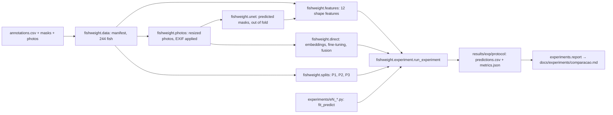

# Repository Guidelines

## Project Overview
Research project that estimates fish body weight in grams from a single top-down photo. It started as a thesis (UFPI, 2023) and is being rebuilt in three phases: reproducible experiments, a web tool (FishWeight), and a paper.

- **Where the work stands:** `docs/ROADMAP.md`. Read it first.
- **What is being built and why:** `docs/superpowers/specs/2026-11-15-evolucao-fishweight-design.md`.
- **What has been implemented:** `docs/experiments/tecnicas.md` (hand-written, one section per technique, no numbers).
- **Metrics of every technique side by side:** `docs/experiments/comparacao.md` (generated; never edit by hand).
- **Reading of the first results:** `docs/experiments/relatorio-fase1a.md` (frozen snapshot).
- **Literature notes:** `docs/research/` (AI-generated; verify every citation at the source).
- **The thesis:** `docs/monografia/monografia.pdf` and `docs/monografia/figuras/`.

## Architecture & Data Flow


- **Every experiment goes through `run_experiment`.** A script supplies `fit_predict(train, test) -> predictions`; the executor owns the folds, hides `weight` from the test rows, adds a `fold` column to them, and writes the outputs. Don't write evaluation loops elsewhere. The one exception is `e1_monografia`, which reproduces the thesis on its original 245 rows.
- **Three protocols, fixed in `data/splits/*.json`:**
  - `p1`: the thesis's 70/30 split (74 test fish).
  - `p2`: 5-fold stratified by species group, 3 repeats.
  - `p3`: leave one collection session out (5 folds). **P3 picks the winning model.**
- **`mask` field of each run** says where the test measurements come from:
  - `manual`: hand-annotated mask. Not available to the tool, so never a candidate.
  - `predita`: mask predicted by a U-Net that never saw that photo. Training still uses manual-mask features.
  - `nenhuma`: the model uses only the photo.
- **Reference-only runs** (`reference_only=True`) use information the tool won't have: annotated species, tape-measured length, or the thesis's leaky feature selection. Never candidates.
- **Scale is preserved.** Photos come from a fixed camera (about 125 px/cm). Every resize keeps the 3:4 proportion; augmentation only flips and jitters brightness/contrast. Never zoom, crop-resize or stretch.
- **Join key:** the image filename `IMG_YYYYMMDD_HHMMSS.jpg`. The date is the collection session.

## Key Directories
| Path | Purpose |
|---|---|
| `fishweight/data.py` | `load_manifest()`, `EXCLUDED_IMAGES`, `REPO_ROOT`, `DATA_DIR` |
| `fishweight/splits.py` | `build_splits`, `load_splits`, `PROTOCOLS`; `python -m fishweight.splits` rewrites `data/splits/` |
| `fishweight/features.py` | `load_mask`, `mask_features`, `FEATURE_NAMES`, `build_feature_table`, `load_predicted_features`, `with_predicted_test_features` |
| `fishweight/metrics.py` | `regression_metrics` (n, mae, rmse, mape, r2, bias), `bootstrap_ci`, `weight_band` |
| `fishweight/experiment.py` | `run_experiment`, `FitPredict` |
| `fishweight/allometric.py` | `AllometricRegressor` (`W = a·Areaᵇ`, optional per-species coefficients) |
| `fishweight/regressors.py` | `make_models()`: fresh instances of the thesis's seven regressors |
| `fishweight/photos.py` | `load_image_small` (applies EXIF orientation), `resize_mask`, `load_photos`, `load_masks` (cache in `data/cache/`, ignored) |
| `fishweight/torch_utils.py` | `pick_device`, `to_tensor`, `augment`, `shuffled_batches` |
| `fishweight/unet.py` | U-Net (MobileNetV2 encoder): `IMAGE_SIZE`, `train_unet`, `predict_masks`, `dice_iou` |
| `fishweight/direct.py` | Photo → weight: `BACKBONES`, `embed`, `add_embeddings`, `train_regressor` (accepts `backbone_state` for transfer), `FittedRegressor`, `direct_fit_predict` |
| `fishweight/fdwe.py` | Public FDWE dataset, read straight from the zip: `download_fdwe`, `parse_labels`, `load_fdwe_manifest`, `crop_fish`, `load_fdwe_crops` |
| `experiments/common.py` | `run_both_masks`, `run_once` / `is_done` (skip finished runs), `run_and_report`, `save_cross_domain`, `best_finetuned`, `sklearn_fit_predict`, `training_arguments` |
| `experiments/e0_allometric.py`, `e1_regionprops.py` | Light: mask-based baselines |
| `experiments/segmentation.py`, `e2_direct.py`, `e3_multitask.py`, `e4_hybrid.py`, `f_fdwe.py` | Heavy: train networks. Run remotely |
| `experiments/check_scale.py`, `report.py` | Scale check; generates `comparacao.md` |
| `remote/executar.ipynb` | Kaggle/Colab runner: clone, install, test, run everything, zip results |
| `results/` | Versioned, small text only: `<experiment>/<protocol>/{predictions.csv,metrics.json}`, `segmentation/<protocol>/metrics.csv`, `checks/escala.csv`. They are the record behind `comparacao.md` and the paper; GPU runs can't be regenerated here. The predicted-mask PNGs (`segmentation/<protocol>/masks/`) are git-ignored: keep them from the results zip |
| `data/coletas/combined/` | Dataset: `images/`, `masks/`, `annotations.csv` (245 rows) |
| `data/splits/`, `data/features/` | Fixed folds; mask features (`manual.csv`, `predita_<protocol>.csv`) and frozen embeddings (`embeddings_<backbone>.npz`) |
| `data/monografia/` | The thesis's two feature tables: `combined_features.csv` (used by `e1_monografia`) and `features_from_unet_predictions.csv` (its `label` column defines the P1 test set) |
| `docs/superpowers/plans/` | Implementation plans, one per roadmap row, with per-step checkboxes |
| `docs/diagramas/` | The README's figures: nine animated SVGs (one per technique, plus overview and evaluation) and `exemplo-peixe.jpg`. Edited by hand, no generator; a new technique gets its figure and README section in the same commit |

`monografia/` holds the author's original thesis code (`notebooks/`, `commons.py`, `feature_extraction.py`, `handcraft_segmentation/`, `yolo_v8_instance_seg/`, `models/unet_model.h5`). **It is his record: never edit or delete it.** Nothing in `fishweight/` or `experiments/` imports it; it was the reference for `e1_monografia` and for the U-Net architecture.

## Development Commands
Run everything from the repo root.
```bash
uv sync                                        # local environment
uv run pytest -q -m "not slow"                 # everyday suite, about 10 s
uv run pytest -q                               # adds tiny network trainings on CPU, about 1 min
uv run python -m experiments.e0_allometric     # light experiments: fine to run here
uv run python -m experiments.e1_regionprops
uv run python -m experiments.e4_hybrid --only-frozen
uv run python -m experiments.check_scale
uv run python -m experiments.report            # regenerate docs/experiments/comparacao.md
```
Heavy scripts (`segmentation`, `e2_direct`, `e3_multitask`, `e4_hybrid` without `--only-frozen`) take `--protocols` and `--epochs`; run them through `remote/executar.ipynb`. There is no linter, formatter or CI. Don't add tooling unless asked.

## Code Conventions & Common Patterns
- **Language:** identifiers are English snake_case. Docstrings, comments, error messages and printed output are **Portuguese**. Keep that split.
- Every module starts with `from __future__ import annotations` and uses type hints.
- **Style:** small flat modules of plain functions; classes only where state is needed (`AllometricRegressor`, `WeightRegressor`, `FittedRegressor`). Configuration lives in module constants (`FEATURE_NAMES`, `WORK_SCALE`, `IMAGE_SIZE`, `BACKBONES`, `EXCLUDED_IMAGES`).
- **Paths** are built from `fishweight.data.REPO_ROOT`, never from the working directory.
- **Errors:** validate at the boundary and raise `ValueError` naming the file or fold. No silent row drops, no broad `except`.
- **Reproducibility:** `random_state=0` / `seed=0` everywhere. Models are created fresh inside `fit_predict` for each fold.
- **No leakage:** scaling, encoders, feature selection and any tuning are fitted inside `fit_predict` on the training rows only. Networks train for a fixed number of epochs: no early stopping, no checkpoint picking. Auxiliary labels (species, tape measures) enter the loss only.
- **Device-agnostic:** get the device from `pick_device()` (`cuda`, then `mps`, then `cpu`); never hard-code one.
- **Resumable heavy work:** expensive runs go through `run_once`, which skips a run whose `metrics.json` exists. To redo one, delete its folder.
- **Graceful when remote outputs are missing:** scripts print what to run first and skip that part (`run_both_masks` without predicted masks, `e4_hybrid` without embeddings).
- **Exclusions** go in `EXCLUDED_IMAGES` with the reason. Never edit `annotations.csv`. After changing exclusions, rerun `python -m fishweight.splits` and `python -m fishweight.features`.
- **Parallelism:** joblib `Parallel(n_jobs=-2)` for reading photos and masks. There is no async code.

## Important Files
- `data/coletas/combined/annotations.csv`: columns `img,specie,weight,width,length`; weight in grams, tape measures in cm. Species names have accents (`tilápia`, `curimatã`).
- `data/splits/p1.json`, `p2.json`, `p3.json`: a test guards them against drift from `build_splits`.
- `pyproject.toml`, `uv.lock`: dependencies. Floors are deliberately low so `pip install -e .` on Kaggle/Colab reuses their preinstalled PyTorch.
- `fishweight/direct.py:BACKBONES`: short name → pinned `timm` weights and input size. Check a new entry builds at its size before using it.

## Runtime/Tooling Preferences
- Python 3.11+ (3.12 locally), managed by `uv` here and plain `pip install -e .` remotely.
- **Heavy training does not run on this MacBook** (Apple M4, 16 GB). This machine is for writing code, running tests and the light experiments. Anything that trains a network on the real data runs on Kaggle, Colab or a GPU PC through `remote/executar.ipynb`: push the branch, run the notebook, download `resultados_fishweight.zip`, unzip at the repo root, then run `experiments.report` locally.
- Before handing a heavy script to a remote run, smoke it locally with a tiny backbone (`resnet10t`), one epoch, one protocol and a small data sample, then delete the outputs. That is the only network work done on this machine.
- `data/external/fdwe/` holds the FDWE zip (2.4 GB, CC BY 4.0, MD5 in `fishweight/fdwe.py`). It is read without extracting. Tests that need it skip when it is absent.
- Large binaries are committed without LFS. Don't add more; external datasets go in `data/external/` (ignored).

## Testing & QA
- pytest, tests in `tests/`, one file per module; shared synthetic data in `tests/helpers.py`. Write the test first and watch it fail.
- Tests that build or train a network are marked `@pytest.mark.slow` and use tiny inputs and `pretrained=False` on CPU.
- Tests assert exact values on small synthetic inputs, plus invariants on the real dataset (244 fish, fold partitions, no train/test overlap, photo/mask alignment).
- A result is only reported after its experiment script ran and `experiments.report` regenerated the table. Numbers are never typed by hand into docs.
- **Every new technique** ships with its section in `docs/experiments/tecnicas.md`, including its row in the status table (code ready / executed).

## Gotchas
- **The thesis model was not image-only.** Its feature selection kept the tape-measured `length` and the annotated species, and was computed on the full dataset. `e1_monografia` reproduces that on purpose.
- **Photos carry EXIF orientation.** 22 of the 245 are stored rotated; the manual masks are in the EXIF-corrected frame. Always read photos through `load_image_small`, never raw.
- **`timm` default weights change between versions** (e.g. `convnext_tiny` now defaults to DINOv3 weights). `BACKBONES` pins the tag; keep it pinned.
- **ViT input size** must be a multiple of the patch (14) and is passed as `img_size` at creation; convolutional backbones take any multiple of 32.
- **FDWE occlusion codes look like numbers** (`31_60`): Python's `float("31_60")` returns 3160. Read them as text through `fdwe.OCCLUSION`.
- **FDWE scale differs from ours** (other camera and distance). Crops go on a fixed canvas so scale is consistent *within* FDWE; never resize a box to fill the frame.
- **GPU training is not bit-reproducible.** Saved masks and `results/` are the record.
- **Lasso needs `max_iter`.** `make_models()` defaults to scikit-learn's 1000 to match the thesis, which does not converge on these data; new experiments pass `max_iter=200_000`.
- **`e1_monografia` emits three warnings** (two convergence, one ill-conditioned matrix). They are expected and faithful to the original.
- **Data decisions are recorded, with evidence, in `docs/experiments/decisoes-dados.md`.** In code they live in `fishweight/data.py`:
  - `EXCLUDED_IMAGES`: out of every experiment (the 0.6 g lambari).
  - `SUSPECT_WEIGHTS`: kept in train and test; `comparacao.md` reports the candidate with and without them (the 1760 g curimatã).
  - `UNRELIABLE_MEASURES`: weight is used, tape length/width are not (two traíras). `direct_fit_predict` and `session_scale` honour it.
- **Session 2022-10-29 has a higher pixel-per-tape-centimetre ratio** (about 131 against 125). Whether the camera or the tape changed is unknown; the `*_escala_sessao` reference runs give mixed evidence. Don't "correct" the data.
- **Collection dates:** the article uses the six dates in the photos' EXIF (they match the filenames); the thesis text says otherwise.
