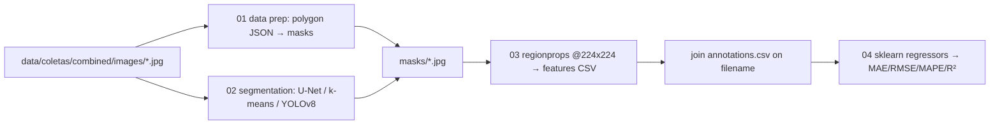

# Repository Guidelines

## Project Overview
Research code from a thesis. It estimates fish body weight from photos. A U-Net (MobileNetV2 encoder) segments the fish body. skimage `regionprops` then measures shape features (area, perimeter, axis lengths, …). Finally, scikit-learn regressors predict the weight in grams. The dataset has 245 fish from Piauí, and the best reported result is R² ≈ 0.90.

`README.md` holds only the abstract, in Portuguese. The full text is the root PDF `Predição de peso de peixes utilizando técnicas de visão computacional.pdf`. `ESTRUTURA.md` is the restructuring plan, in Portuguese and partly outdated (see Gotchas).

## Architecture & Data Flow
The code is notebook-driven research code. There is no CLI, no app and no packaging.



- **Join key:** the image filename `IMG_YYYYMMDD_HHMMSS.jpg`. It appears as `annotations.csv:img` and as the `label` column of the features CSVs.
- **Two copies of the shared code:**
  - **Root modules** `commons.py` and `feature_extraction.py`. These are what the notebooks use, via bare `from commons import …` imports.
  - **The `src/` package**, a refactored copy that no notebook imports yet. Its modules use absolute imports (`from src.commons import …`), so they need the repo root on `sys.path`.
- **Identical files:** root `commons.py` = `src/commons.py`, and root `feature_extraction.py` = `src/feature_extraction.py` (byte-identical, checked with `cmp`). **Edit both or neither** until the notebooks migrate to `src`.

## Key Directories
| Path | Purpose |
|---|---|
| `src/commons.py` | skimage mask utilities: `binarize_image`, `find_bighest_cluster`, `auto_invert_image_mask`, `find_roi`, `check_colision_border`, `load_images_from_directory[_resize]` (joblib `n_jobs=-2`) |
| `src/feature_extraction.py` | `ALL_REGION_PROPS_PROPERTIES`, `extract_features_from_images(...)` → CSV |
| `src/segmentation/unet.py` | `DIM=224`, `unet_model` (MobileNetV2 with pix2pix upsampling), `vanilla_unet`, `build_and_compile_unet`, `load_unet` (registers `dice_coef`, `iou_coef`), `create_mask` |
| `src/segmentation/handcraft.py` | k-means, Canny and hole-filling segmentation |
| `src/segmentation/yolo.py` | `YOLOSegmentation.detect` → `(bboxes, class_ids, contours, scores)`, or four empty tuples on any exception |
| `src/regression/dataset.py` | `load_dataset(base_path)`, `load_unet_dataset(df, features_file=...)` |
| `src/regression/models.py` | `DEFAULT_MODELS`, `handle_model_evaluate`, `run_all_algs`, `apply_kfold` (KFold 5, `random_state=0`), `apply_pca_reduce`, `corr_view` |
| `notebooks/01_data_preparation/` | `sorted_frames.ipynb` (EXIF ordering), `convert_polygon2mask.ipynb` |
| `notebooks/02_segmentation/` | `unet_training.ipynb` (the main one), `kmeans_*`, `handcraft_*`, `yolo_*`, `unsupervised_autoencoder.ipynb` |
| `notebooks/03_feature_extraction/` | `features_from_unet.ipynb`: predicts masks for the 30% test split and writes `features_from_unet_predictions.csv` |
| `notebooks/04_regression/` | `regression_experiments.ipynb` (main; `regression_last_execution.ipynb` is a near-copy), `regression_cleaner_data.ipynb` |
| `handcraft_segmentation/`, `yolo_v8_instance_seg/` | Legacy pre-`src` code. `yolo_v8_instance_seg/main.py` is a pysource tutorial demo (rugby image, COCO class 32) with nothing fish-specific |
| `data/coletas/` | Dataset, **tracked in Git** even though `.gitignore` lists `data/coletas` (new files there are ignored). `combined/{images,masks,annotations.csv}` has 245 rows. `combined_no_29_11_22/` has masks and annotations only (166 rows) |
| `models/unet_model.h5` | Trained Keras U-Net (60 MB, committed) |
| `figures/` | PDFs used in the thesis |

## Development Commands
```bash
python3.9 -m venv .venv && source .venv/bin/activate   # notebooks were saved under Python 3.9.13
pip install -r requirements.txt
pip install git+https://github.com/tensorflow/examples.git   # tensorflow_examples (pix2pix), if the PyPI name fails
jupyter lab            # launch from the repo root; notebook paths assume data/coletas/... from root
```
There is no build step, no linter, no formatter and no CI. Don't add tooling unless asked.

## Code Conventions & Common Patterns
- **Language:** identifiers are English snake_case. Docstrings, comments and printed messages are **Portuguese**, using Google-style `Args:`/`Returns:`. Keep that split.
- **Function-name typos:** existing names contain typos (`find_bighest_cluster`, `check_colision_border`, `apply_filter_each_chanel`). They are public names, so don't rename them without updating every caller and notebook.
- Every `src` module starts with `from __future__ import annotations` and uses type hints throughout.
- **Style:** plain functions, no classes except `YOLOSegmentation`. No dependency injection. Configuration lives in module constants (`DIM`, `DEFAULT_MODELS`, `ALL_REGION_PROPS_PROPERTIES`).
- **Parallelism:** image loading uses joblib `Parallel(n_jobs=-2)(delayed(...))`. There is no async code.
- **Reproducibility:** `random_state=0` everywhere. The train/test split is `test_size=0.3`.
- **Error handling is minimal:** broad `except Exception` that prints a message and continues, or returns empty values. `find_bighest_cluster` raises `ValueError` when no regions are found.
- **Shared estimators:** `DEFAULT_MODELS` holds module-level estimator instances that `fit` mutates. Clone them (`sklearn.base.clone`) if you need independent fits.

## Important Files
- `src/regression/dataset.py`
  - `load_dataset("data/coletas/combined")` reads or creates `combined_features.csv` in the **current working directory**.
  - It fails if `base_path` has a trailing `/`.
- `combined_features.csv` (245 rows) and `features_from_unet_predictions.csv` (74 rows, the U-Net test split) share one 53-column regionprops schema, with `label` holding the filename.
- `data/coletas/combined/annotations.csv`: columns `img,specie,weight,width,length`. Species names are Portuguese with accents (`tilápia`, `curimatã`, `tambaqui`, `panga`).
- `models/unet_model.h5`: load it via `src.segmentation.unet.load_unet(path)`. Plain `keras.models.load_model` needs `custom_objects={"dice_coef", "iou_coef"}`.

## Runtime/Tooling Preferences
- Python 3.9, pip with `requirements.txt`. There is no lockfile and versions are mostly unpinned; floors are `tensorflow>=2.10`, `pandas>=2.0`, `scikit-image>=0.19`, `scikit-learn>=1.0`.
- Use `pd.concat` and never `DataFrame.append`, which was removed in pandas 2.
- Large artifacts (the `.h5` model and the PDFs) are committed without LFS. Don't add more binaries.
- YOLO weights (`yolov8*-seg.pt`) are not in the repo; ultralytics downloads them on first use.

## Testing & QA
There are no tests, test config or CI. Results are validated by hand through metrics printed in the notebooks:
- regression: MAE, MSE, RMSE, MAPE and R² (`handle_model_evaluate`), 5-fold CV (`apply_kfold`), and yellowbrick `PredictionError`/`ResidualsPlot`;
- segmentation: BinaryIoU, `dice_coef` and `iou_coef`.

Minimal checks after editing, run from the repo root:
```bash
python -m py_compile commons.py feature_extraction.py src/*.py src/*/*.py
python -c "import src.commons, src.feature_extraction, src.regression.models, src.regression.dataset"
python -c "import src.segmentation.unet"   # heavy: TensorFlow + tensorflow_examples
cmp commons.py src/commons.py && cmp feature_extraction.py src/feature_extraction.py   # keep duplicates in sync
```
For new non-trivial logic, add a small `pytest` test under `tests/`; there is no existing convention.

## Gotchas
- **Missing numpy import:** `feature_extraction.py` (both copies) uses `np.asarray` without `import numpy as np`.
  - Any non-`None` `images_arr`, including the `[]` that `load_dataset` passes, raises `NameError`.
  - It only works today because `combined_features.csv` is already cached.
- **Paths:** every path is relative to the working directory, and several are stale.
  - Notebooks load `unet_model.h5` from their own folder, but the file is at `models/unet_model.h5`.
  - `regression_cleaner_data.ipynb` uses `combined_v2` and `Dia 29-11-2022 - OK`; the handcraft/kmeans notebooks use `data/images`; `unsupervised_autoencoder.ipynb` uses `Dia 26-11-2022`. None of these exist.
- **Notebook imports:** notebooks under `notebooks/NN_*/` import the root `commons`/`feature_extraction` (and `yolo_segmentation` from `yolo_v8_instance_seg/`). These resolve only if the kernel's working directory or `sys.path` includes the right folder.
- **`create_mask`** (`unet.py`) applies `argmax` to a 1-channel sigmoid output, so it always returns 0. Threshold at 0.5 when you need real masks.
- **`check_colision_border`** assumes square masks, and its side names are swapped.
- **Feature names:** `bbox_area`, `convex_area` and `filled_area` are deprecated regionprops names in newer scikit-image, and the CSV schema depends on them.
- **`yolo_v8_instance_seg/binary_masks.ipynb`** has `YOLO` commented out. A bare `except` swallows the error, so every mask comes out all ones.
- **`ESTRUTURA.md` is outdated:** its "Estrutura Atual" and pipeline sections name old notebook files and old locations. Trust this file and the tree over it.
