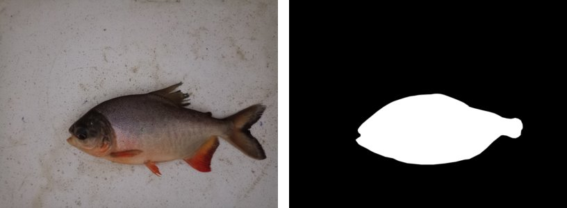

# FishWeight — estimativa do peso de peixes por imagem

Estima o peso de um peixe, em gramas, a partir de uma única foto tirada de cima, numa caixa com a câmera fixa na tampa. O projeto nasceu de uma monografia (UFPI, 2023) e está sendo evoluído em três fases: experimentos reprodutíveis, uma ferramenta web e um artigo.



Há três caminhos da foto ao peso, e o projeto compara todos sob as mesmas regras:

- **Medir a máscara.** Uma rede recorta o corpo do peixe; do recorte saem medidas de forma; um regressor transforma as medidas em gramas (E0 e E1).
- **Regressão direta.** Uma rede de visão olha a foto inteira e devolve o peso, sem máscara (E2 e E3).
- **Híbrido.** O modelo recebe as medidas da máscara e o resumo da foto ao mesmo tempo (E4 e E5).

## Sumário

- [Um exemplo](#um-exemplo)
- [Dados](#dados)
- [Como cada técnica é medida](#como-cada-técnica-é-medida)
- [Técnicas comparadas](#técnicas-comparadas)
- [Resultados até agora](#resultados-até-agora)
- [Como rodar](#como-rodar)
- [Estrutura do repositório](#estrutura-do-repositório)
- [Fases do projeto](#fases-do-projeto)
- [Documentos](#documentos)

## Um exemplo



Este tambaqui (`IMG_20221122_174727.jpg`) pesou 325 g na balança. À esquerda está a foto; à direita, a máscara do corpo anotada à mão, sem as nadadeiras. Ele serve de exemplo nas seções abaixo. Os valores vêm da avaliação mais dura: o modelo foi ajustado sem nenhum peixe do dia 22/11/2022, que é o dia em que esse foi fotografado.

| Técnica | O que usou | Peso previsto | Erro |
|---|---|---|---|
| E0, fórmula alométrica | Só a área da máscara | 355 g | +30 g |
| E1, regressão Ridge | As 12 medidas da máscara | 352 g | +27 g |

O erro desse peixe fica perto do erro mediano das duas técnicas (27 g e 24 g); ele não foi escolhido por ser um caso bom.

## Dados

- **Coleta própria:** 245 fotos de peixes de seis espécies (tambaqui, tilápia, curimatã, panga, traíra e lambari), feitas em seis dias de 2022 na Fazenda Pajeú, em Morro do Chapéu, Piauí. Cada peixe tem a foto, a máscara do corpo anotada à mão, o peso e o comprimento e a largura medidos com fita. Ficam em `data/coletas/combined/`.
- **Um peixe fica de fora:** um lambari com peso anotado de 0,60 g. Os experimentos usam 244 peixes.
- **Três registros com anotação duvidosa** continuam no conjunto, com tratamento explícito. Estão descritos em [`docs/experiments/decisoes-dados.md`](docs/experiments/decisoes-dados.md).
- **Dataset público FDWE:** 2.216 peixes do Mar do Norte fotografados numa esteira (Wageningen, 2023, licença CC BY 4.0). É usado só nos experimentos F1 e F2 e fica fora do Git.

## Como cada técnica é medida



Os peixes são divididos em partes, chamadas dobras. Em cada dobra, o modelo é ajustado com uma parte dos peixes e testado nos demais, cujo peso ele não vê. As divisões estão gravadas em `data/splits/` e são as mesmas para todas as técnicas.

| Protocolo | Como divide | Para que serve |
|---|---|---|
| P1 | O mesmo 70/30 da monografia (74 peixes de teste) | Comparar com os números antigos |
| P2 | 5 partes com a mesma proporção de espécies, repetido 3 vezes | Estimativa estável no cenário favorável |
| P3 | Um dia de coleta inteiro fora do treino, um por vez | Saber se o modelo funciona num dia que nunca viu. **É o que decide o vencedor** |

As métricas são o MAE (erro médio em gramas), o RMSE (parecido, mas pesa mais os erros grandes), o MAPE (erro médio em porcentagem do peso) e o R² (quanto da variação do peso o modelo explica; 1 é o máximo). O MAE vem com intervalo de confiança de 95%.

Três regras valem para todas as técnicas:

- **Nada do teste entra no treino.** Normalizações, escolha de parâmetros e a própria rede de segmentação são ajustadas só com os peixes de treino da dobra.
- **O tamanho do peixe na imagem é preservado.** As fotos são reduzidas sem esticar e sem zoom, porque é o tamanho em pixels que liga a imagem ao peso.
- **Só concorre o que a ferramenta terá.** A ferramenta recebe apenas a foto. Variantes que usam a máscara manual, a espécie anotada ou a medida de fita aparecem como referência, marcadas com `(ref.)`.

## Técnicas comparadas

| Técnica | Entrada | Estado |
|---|---|---|
| [Segmentação](#segmentação--u-net) | Foto | P1 executado; P2 e P3 aguardam GPU |
| [E0](#e0--piso-alométrico) | Área da máscara | Executado com máscara manual; com máscara prevista, só P1 |
| [E1](#e1--regressores-sobre-as-medidas) | 12 medidas da máscara | Executado com máscara manual; com máscara prevista, só P1 |
| [E2](#e2--regressão-direta-da-foto) | Foto | Código pronto; aguarda GPU |
| [E3](#e3--multitarefa) | Foto | Código pronto; aguarda GPU |
| [E4 e E5](#e4-e-e5--híbrido) | Foto e 12 medidas | Código pronto; aguarda GPU |
| [F1 e F2](#f1-e-f2--dataset-público-fdwe) | Foto, com o FDWE no treino | Código pronto; aguarda GPU |

"Aguarda GPU" quer dizer que o código está escrito e testado com uma rede minúscula, mas ainda não rodou nos dados reais. A descrição completa de cada técnica, com parâmetros, está em [`docs/experiments/tecnicas.md`](docs/experiments/tecnicas.md).

### Segmentação — U-Net



- **O que faz:** recebe a foto e devolve a máscara do corpo do peixe. Dessa máscara saem as 12 medidas usadas em E0, E1, E4 e E5.
- **Como:** U-Net com codificador MobileNetV2 pré-treinado, em PyTorch, com a foto reduzida para 192×256 e 20 épocas de treino.
- **Cuidado principal:** a máscara de cada peixe de teste vem de uma rede que não treinou com ele. São 21 redes ao todo, uma por dobra.
- **Por que importa:** os números com máscara manual dizem o melhor que as medidas podem dar. A ferramenta só terá a máscara prevista, então é com ela que E0 e E1 concorrem.
- **Exemplo (P1):** nas 74 fotos de teste, o Dice médio entre a máscara prevista e a manual é de 0,981 (1 seria idêntica). Com a máscara prevista, o erro do E1 Ridge passa de 35,7 g para 36,4 g.

```bash
uv run python -m experiments.segmentation   # treina as 21 redes; precisa de GPU
```

### E0 — Piso alométrico



- **O que faz:** estima o peso só pela área da máscara, com a fórmula `peso = a × áreaᵇ`. São dois coeficientes, ajustados nos peixes de treino.
- **Papel:** é o modelo mais simples possível. Qualquer técnica mais complexa precisa superá-lo.
- **Variantes:** uma fórmula para todos os peixes (`e0_global`); uma por espécie anotada (`e0_especie_oraculo`, referência); com a área convertida para cm² pela escala de cada dia de coleta (`e0_global_escala_sessao`, referência).
- **Exemplo:** na dobra do tambaqui acima, o ajuste deu `a = 0,000281` e `b = 1,345`. A área dele é de 34.311 pixels, e `0,000281 × 34.311^1,345` dá 355 g.

```bash
uv run python -m experiments.e0_allometric
```

### E1 — Regressores sobre as medidas



- **O que faz:** mede 12 atributos de forma na máscara (área, eixos maior e menor, perímetro, solidez e outros) e entrega a um regressor.
- **Regressores:** os mesmos sete da monografia: Linear, Ridge, Lasso, Random Forest, Gradient Boosting, PCA seguido de Linear e Polinomial seguido de Lasso.
- **Variantes:** só as medidas (`e1_nativo_<Modelo>`); medidas mais a espécie anotada (`..._especie_oraculo_...`, referência); medidas em centímetros (`..._escala_sessao`, referência).
- **Reprodução da monografia:** `e1_monografia_<Modelo>` repete o método original para conferir os números antigos. É referência porque aquele método usava o comprimento medido com fita e a espécie anotada, e escolhia as medidas olhando também os peixes de teste.
- **Exemplo:** o tambaqui acima tem eixo maior de 321 pixels, eixo menor de 140 e perímetro de 853. O Ridge prevê 352 g.

```bash
uv run python -m experiments.e1_regionprops
```

### E2 — Regressão direta da foto



- **O que faz:** uma rede de visão recebe a foto inteira e estima o peso, sem máscara.
- **Rede congelada:** uma rede já treinada em milhões de imagens resume cada foto num vetor de números, sem ser alterada. Sobre os vetores ajusta-se um modelo pequeno (Ridge ou uma rede de uma camada). Vale para ResNet50, EfficientNet-B3, ConvNeXt-Tiny e DINOv2.
- **Ajuste fino:** a rede inteira é treinada para prever o peso, em gramas ou em logaritmo, por 30 épocas. Vale para as três primeiras.
- **Exemplo:** cada combinação vira uma linha da comparação, como `e2_resnet50_congelado_ridge` e `e2_resnet50_ajuste_log`.

```bash
uv run python -m experiments.e2_direct
```

### E3 — Multitarefa



- **O que faz:** durante o treino, a rede do E2 aprende também a dizer a espécie (`e3_<rede>_especie`) ou o comprimento e a largura (`e3_<rede>_medidas`). A ideia é que aprender essas tarefas vizinhas ajude a estimar o peso.
- **Cuidado principal:** a espécie e as medidas de fita entram só no cálculo do erro de treino. Na hora de prever, o modelo recebe apenas a foto, e um teste automatizado garante isso.
- **Rede usada:** a de menor erro em P3 no ajuste fino do E2.

```bash
uv run python -m experiments.e3_multitask
```

### E4 e E5 — Híbrido



- **O que faz:** junta as 12 medidas da máscara com o vetor que a rede de visão tira da foto. As medidas trazem o tamanho; a foto traz textura e espessura aparente.
- **E4:** a junção é feita de dois modos. Com a rede congelada, medidas e vetor entram num Ridge ou num Gradient Boosting (`e4_<rede>_congelado_ridge`, `..._gbr`). No ajuste fino, as medidas entram por uma camada própria dentro da rede (`e4_<rede>_fusao`).
- **E5:** a fusão dentro da rede, com a espécie como saída auxiliar de treino (`e5_<rede>_fusao_especie`).
- **Cuidado principal:** os modelos de fusão treinam com as medidas da máscara manual e são testados com as da máscara prevista, que é o que a ferramenta terá.

```bash
uv run python -m experiments.e4_hybrid
```

### F1 e F2 — Dataset público FDWE



- **O que faz:** testa se um conjunto público maior, de outras espécies e outra câmera, melhora o modelo.
- **F1, pré-treino** (`f1_<rede>_pre_fdwe`): a rede aprende a estimar peso no FDWE e depois recebe o ajuste fino nas fotos da coleta. Comparado ao E2 com a mesma rede, mostra se o pré-treino ajudou.
- **F2, domínio cruzado** (`f2_<rede>_fdwe_para_coleta` e o sentido inverso): a rede treina num conjunto e é testada no outro, sem ajuste. Mede o quanto os dois conjuntos diferem; não concorre a vencedor.
- **Preparo:** cada peixe do FDWE é recortado e colado numa tela de tamanho fixo, para que um peixe maior continue ocupando mais pixels. Entram os 1.590 peixes com até 30% do corpo encoberto.

```bash
uv run python -m experiments.f_fdwe
```

## Resultados até agora

Só E0 e E1 rodaram nos três protocolos, e apenas com máscara manual. Por isso ainda não há vencedor: nenhuma técnica que concorre foi executada em P3. Os valores abaixo são de 16/11/2026.

| Técnica | Máscara | P1: MAE (g) | P2: MAE (g) | P3: MAE (g) [IC 95%] | P3: R² |
|---|---|---|---|---|---|
| E1 Ridge | manual | 35,7 | 33,7 | 38,3 [31,7; 46,1] | 0,925 |
| E1 Lasso | manual | 37,4 | 35,2 | 40,6 [33,9; 48,3] | 0,920 |
| E0 global | manual | 43,8 | 39,7 | 41,3 [34,5; 49,5] | 0,917 |
| E1 Ridge | prevista | 36,4 | aguarda GPU | aguarda GPU | – |
| E0 global | prevista | 42,2 | aguarda GPU | aguarda GPU | – |

A tabela completa, com todas as variantes, o erro por espécie e por dia de coleta, está em [`docs/experiments/comparacao.md`](docs/experiments/comparacao.md). Esse arquivo é gerado a partir de `results/` e é a fonte dos números; a tabela acima é uma cópia resumida.

## Como rodar

Num computador sem GPU rodam os testes e os experimentos leves:

```bash
uv sync
uv run pytest -q -m "not slow"                # testes rápidos, cerca de 10 s
uv run python -m experiments.e0_allometric
uv run python -m experiments.e1_regionprops
uv run python -m experiments.check_scale      # confere a escala das fotos
uv run python -m experiments.report           # regenera a comparação
```

O treino das redes (segmentação completa e E2 a F2) precisa de GPU:

1. Abra [`remote/executar.ipynb`](remote/executar.ipynb) no Kaggle ou no Colab, com GPU ativada.
2. Execute as células em ordem. O notebook baixa o repositório, instala as dependências, roda os testes e depois todos os experimentos.
3. Baixe o arquivo `resultados_fishweight.zip` que ele gera e descompacte na raiz do repositório.
4. Rode `uv run python -m experiments.report` para atualizar a comparação.

Os scripts de treino aceitam `--protocols` (padrão `p1 p3`; o P2 é opcional pelo custo) e `--epochs`. Uma rodada interrompida continua de onde parou.

## Estrutura do repositório

| Pasta | Conteúdo |
|---|---|
| `fishweight/` | Pacote Python: dados, divisões, métricas, medidas da máscara, U-Net, regressão direta e leitor do FDWE |
| `experiments/` | Um script por experimento, a segmentação, a conferência de escala e o gerador da comparação |
| `tests/` | Testes automatizados |
| `data/coletas/combined/` | Fotos, máscaras e anotações da coleta |
| `data/splits/`, `data/features/` | Divisões fixas e medidas calculadas |
| `data/monografia/` | Tabelas de atributos da monografia, usadas para reproduzi-la |
| `results/` | Predições e métricas de cada experimento, em texto |
| `remote/` | Notebook para executar em Kaggle, Colab ou PC com GPU |
| `monografia/` | Código original da monografia: notebooks, scripts e o modelo U-Net em Keras. Guardado como registro; o projeto novo não o executa |
| `docs/` | Roteiro, técnicas, comparação, decisões, diagramas, pesquisa e a monografia |

## Fases do projeto

| Fase | Entrega | Estado |
|---|---|---|
| 1. Experimentos | Comparação das técnicas sob os mesmos protocolos e escolha do modelo | Código pronto; falta executar em GPU e fechar com intervalos de predição |
| 2. Ferramenta FishWeight | Aplicação web: a pessoa fotografa o peixe e recebe o peso (Next.js, FastAPI, PostgreSQL, Docker Compose) | Não começou |
| 3. Artigo | Texto em português no modelo da SBC, com material suplementar | Não começou |

O andamento detalhado, plano por plano, está em [`docs/ROADMAP.md`](docs/ROADMAP.md).

## Documentos

- [`docs/ROADMAP.md`](docs/ROADMAP.md): onde o trabalho está e o que falta.
- [`docs/experiments/tecnicas.md`](docs/experiments/tecnicas.md): cada técnica em detalhe.
- [`docs/experiments/comparacao.md`](docs/experiments/comparacao.md): métricas de todas as técnicas, lado a lado.
- [`docs/experiments/decisoes-dados.md`](docs/experiments/decisoes-dados.md): decisões sobre registros duvidosos, com a evidência de cada uma.
- [`docs/superpowers/specs/2026-11-15-evolucao-fishweight-design.md`](docs/superpowers/specs/2026-11-15-evolucao-fishweight-design.md): o desenho aprovado das três fases.
- [`docs/monografia/monografia.pdf`](docs/monografia/monografia.pdf): a monografia original.
- [`docs/diagramas/`](docs/diagramas/): os diagramas desta página, em SVG animado.

## Autores

Mateus Pinto Garcia, sob orientação de Romuere Rodrigues Veloso e Silva (UFPI).
