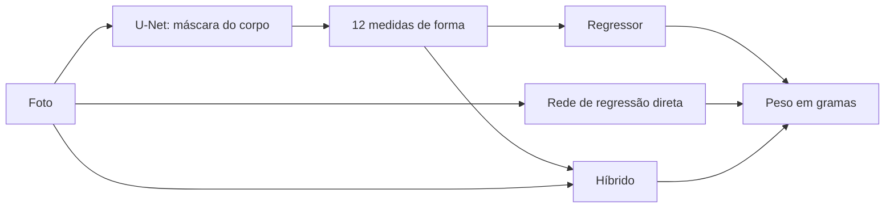

# FishWeight — estimativa do peso de peixes por imagem

Estima o peso de um peixe, em gramas, a partir de uma única foto tirada de cima, numa caixa com a câmera fixa na tampa. O projeto nasceu de uma monografia (UFPI, 2023) e está sendo evoluído em três fases: experimentos reprodutíveis, uma ferramenta web e um artigo.

- **Onde o trabalho está:** [`docs/ROADMAP.md`](docs/ROADMAP.md)
- **O que foi implementado:** [`docs/experiments/tecnicas.md`](docs/experiments/tecnicas.md)
- **Resultados de todas as técnicas:** [`docs/experiments/comparacao.md`](docs/experiments/comparacao.md)
- **Por que e o que está sendo construído:** [`docs/superpowers/specs/2026-11-15-evolucao-fishweight-design.md`](docs/superpowers/specs/2026-11-15-evolucao-fishweight-design.md)
- **Monografia original:** [`docs/monografia/monografia.pdf`](docs/monografia/monografia.pdf)

## Dados

245 peixes de seis espécies (tambaqui, tilápia, curimatã, panga, traíra e lambari), coletados na Fazenda Pajeú, em Morro do Chapéu, Piauí. Cada peixe tem uma foto, a máscara do corpo anotada à mão, o peso e as medidas de comprimento e largura. Ficam em `data/coletas/combined/`.

## Como funciona



Todas as técnicas são avaliadas nas mesmas divisões de treino e teste. A que decide é a mais dura: deixar um dia de coleta inteiro fora do treino.

## Estrutura

| Pasta | Conteúdo |
|---|---|
| `fishweight/` | Pacote Python: dados, divisões, métricas, medidas da máscara, U-Net, regressão direta |
| `experiments/` | Um script por experimento (`e0` a `e4`), segmentação, conferência de escala e relatório |
| `tests/` | Testes automatizados |
| `data/coletas/combined/` | Fotos, máscaras e anotações |
| `data/splits/`, `data/features/` | Divisões fixas e medidas calculadas |
| `data/monografia/` | Tabelas de atributos da monografia, usadas para reproduzi-la |
| `results/` | Predições e métricas de cada experimento |
| `remote/` | Notebook para executar em Kaggle, Colab ou PC com GPU |
| `monografia/` | Código original da monografia: notebooks, scripts e o modelo U-Net em Keras. Guardado como registro; o projeto novo não o executa |
| `docs/` | Roteiro, técnicas, comparação, desenho, pesquisa e monografia |

## Como rodar

Neste computador, sem GPU, rodam os testes e os experimentos leves:

```bash
uv sync
uv run pytest -q -m "not slow"
uv run python -m experiments.e0_allometric
uv run python -m experiments.e1_regionprops
uv run python -m experiments.report
```

O treino das redes (segmentação e experimentos E2 a E5) roda num ambiente com GPU: envie o branch ao GitHub, abra [`remote/executar.ipynb`](remote/executar.ipynb) no Kaggle ou no Colab, execute e traga de volta o arquivo de resultados que ele gera.

## Autores

Mateus Pinto Garcia, sob orientação de Romuere Rodrigues Veloso e Silva (UFPI).
