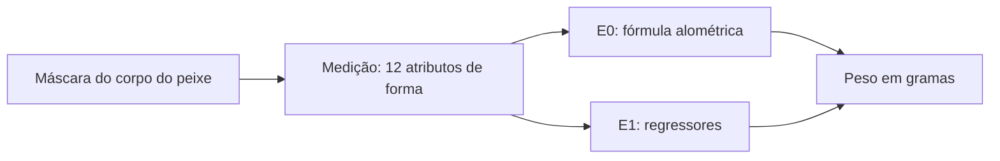

# Técnicas implementadas

Registro do que cada técnica faz, com que entrada e onde está o código. Os números ficam em [`comparacao.md`](comparacao.md), que é gerado a partir de `results/`; aqui não há métricas digitadas.

**Regra:** toda técnica nova ganha uma seção neste arquivo no mesmo commit em que seus resultados entram em `results/`.

## Visão geral

Até aqui, todas as técnicas partem da **máscara manual** (anotada no Labelme). Nenhuma usa a foto colorida e nenhuma rede neural foi treinada.

## Base comum

### Dados

- 244 peixes de `data/coletas/combined/`, um por foto, com peso em gramas.
- O lambari `IMG_20221126_163700.jpg` está fora: o peso anotado é 0,60 g.
- Código: `fishweight/data.py` (`load_manifest`, `EXCLUDED_IMAGES`).

### Medição da máscara

- A máscara (4624×3472) é reduzida 8 vezes por blocos, sem esticar, e fica só o maior componente conexo.
- O `regionprops` do scikit-image mede 12 atributos: área, área da caixa delimitadora, área convexa, área preenchida, eixo maior, eixo menor, excentricidade, diâmetro equivalente, extensão, diâmetro de Feret máximo, perímetro e solidez.
- Posição, orientação e momentos brutos ficam de fora, porque dependem de onde o peixe foi colocado na caixa.
- Diferença para a monografia: lá eram 53 colunas medidas numa imagem esticada para 224×224.
- Código: `fishweight/features.py`. Valores em `data/features/manual.csv`.

### Protocolos de avaliação

| Protocolo | Como divide | Para quê |
|---|---|---|
| P1 | O 70/30 da monografia (74 peixes de teste) | Comparar com os números antigos |
| P2 | 5 partes estratificadas por espécie, repetido 3 vezes | Estimativa estável no cenário favorável |
| P3 | Uma sessão de coleta de fora por vez (5 rodadas) | Generalização para um dia não visto; **decide o vencedor** |

As divisões são fixas (`data/splits/`) e iguais para todas as técnicas. Código: `fishweight/splits.py`.

### Métricas

- MAE e RMSE em gramas, MAPE em %, R² e viés (média de previsto menos real).
- Intervalo de confiança de 95% por bootstrap, reamostrando peixes.
- Erro separado por espécie, por sessão e por faixa de peso.
- Código: `fishweight/metrics.py` e `fishweight/experiment.py`.

## Técnicas

### E0 — Piso alométrico

- **Entrada:** só a área da máscara.
- **Como funciona:** ajusta `peso = a × áreaᵇ` por regressão linear em escala logarítmica. São dois coeficientes.
- **Variantes:**
  - `e0_global`: um par `(a, b)` para todos os peixes.
  - `e0_especie_oraculo` (referência): um par por espécie anotada; espécies com menos de 5 peixes no treino usam o par global.
- **Papel:** é o modelo mais simples possível. Qualquer técnica mais complexa precisa superá-lo.
- **Código:** `fishweight/allometric.py`, `experiments/e0_allometric.py`.

### E1 — Regressores sobre os atributos da máscara

- **Entrada:** os 12 atributos de forma.
- **Como funciona:** os atributos são normalizados (média zero, desvio um, calculados só no treino) e entram num regressor do scikit-learn.
- **Regressores**, os mesmos sete da monografia: Linear, Ridge, Lasso, Random Forest, Gradient Boosting, PCA com 2 componentes seguido de Linear, e Polinomial de grau 3 seguido de Lasso. Todos com os parâmetros padrão; o Lasso roda até convergir.
- **Variantes:**
  - `e1_nativo_<Modelo>`: só os 12 atributos.
  - `e1_nativo_especie_oraculo_<Modelo>` (referência): os 12 atributos mais a espécie anotada.
- **Código:** `fishweight/regressors.py`, `experiments/e1_regionprops.py`.

### E1 monografia — Reprodução do método original

- **Entrada:** as 53 colunas antigas (`combined_features.csv`), o comprimento medido com fita e a espécie anotada.
- **Como funciona:** repete o notebook da monografia. Ficam as colunas com correlação acima de 0,85 com o peso, calculada no conjunto inteiro (teste incluído), mais a espécie. Sem normalização, 245 peixes, só em P1.
- **Papel:** provar que os números antigos são reproduzidos antes de compará-los com os novos. É referência porque usa a fita, a espécie e uma seleção que enxerga o teste.
- **Código:** `experiments/e1_regionprops.py` (`run_monograph`).

### Conferência de escala

- **Entrada:** o diâmetro de Feret da máscara e o comprimento medido com fita.
- **Como funciona:** divide um pelo outro para obter pixels por centímetro em cada foto. Com a câmera fixa na tampa da caixa, o valor deveria ser o mesmo em todas. Fotos que fogem mais de 15% da mediana são sinalizadas.
- **Papel:** não é um modelo; verifica a premissa de escala constante em que todos os modelos se apoiam.
- **Código:** `experiments/check_scale.py`. Valores em `results/checks/escala.csv`.

## Ainda não implementado

| Técnica | O que acrescenta | Plano |
|---|---|---|
| Segmentação automática (U-Net em PyTorch) | Máscara gerada pelo modelo no lugar da manual | 1B |
| E2 — Regressão direta | Rede (ResNet50, EfficientNet-B3, ConvNeXt-Tiny, DINOv2) que prevê o peso a partir da foto | 1C |
| E3 — Multitarefa | Saídas auxiliares de espécie e de medidas | 1C |
| E4, E5 — Híbrido | Junta a representação da rede com os atributos da máscara | 1D |
| F1, F2 — FDWE | Pré-treino e teste cruzado com o dataset público | 1E |
| Intervalo de predição | Faixa de incerteza por predição conforme | 1F |
