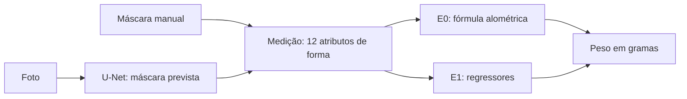

# Técnicas implementadas

Registro do que cada técnica faz, com que entrada e onde está o código. Os números ficam em [`comparacao.md`](comparacao.md), que é gerado a partir de `results/`; aqui não há métricas digitadas.

**Regra:** toda técnica nova ganha uma seção neste arquivo no mesmo commit em que seu código entra.

## Estado de cada técnica

| Técnica | Código e testes | Execução nos dados reais |
|---|---|---|
| Segmentação (U-Net) | Pronto | P1 feito; P2 e P3 aguardam GPU |
| E0 — Piso alométrico | Pronto | Máscara manual: feito. Máscara prevista: só P1 |
| E1 — Regressores sobre a máscara | Pronto | Máscara manual: feito. Máscara prevista: só P1 |
| E2 — Regressão direta da foto | Pronto | Aguarda GPU |
| E3 — Multitarefa | Pronto | Aguarda GPU e o resultado de E2 |
| E4, E5 — Híbrido | Pronto | Aguarda GPU, as máscaras previstas e o resultado de E2 |
| F1, F2 — FDWE | Pronto | Aguarda GPU e o resultado de E2 |
| Intervalo de predição | Não começou | — |

"Aguarda GPU" significa rodar [`remote/executar.ipynb`](../../remote/executar.ipynb) no Kaggle, no Colab ou num PC com placa de vídeo. Os scripts foram exercitados de ponta a ponta com uma rede minúscula e uma época, só para conferir que funcionam; isso não gera resultado.

## Visão geral

Há duas origens para a máscara: a **manual** (anotada no Labelme) e a **prevista** por uma U-Net a partir da foto. A ferramenta só terá a prevista. E0 e E1 usam apenas as medidas da máscara; E2 e E3 usam apenas a foto; E4 e E5 usam as duas coisas.

## Base comum

### Dados

- 244 peixes de `data/coletas/combined/`, um por foto, com peso em gramas.
- O lambari `IMG_20221126_163700.jpg` está fora: o peso anotado é 0,60 g.
- Código: `fishweight/data.py` (`load_manifest`, `EXCLUDED_IMAGES`).

### Medição da máscara

- A máscara (4624×3472) é reduzida 8 vezes por blocos, sem esticar, e fica só o maior componente conexo.
- O `regionprops` do scikit-image mede 12 atributos: área, área da caixa delimitadora, área convexa, área preenchida, eixo maior, eixo menor, excentricidade, diâmetro equivalente, extensão, diâmetro de Feret máximo, perímetro e solidez.
- Posição, orientação e momentos brutos ficam de fora, porque dependem de onde o peixe foi colocado na caixa.
- Diferença para a monografia: lá eram 53 colunas medidas numa imagem esticada para 224×224.
- Código: `fishweight/features.py`. Valores em `data/features/manual.csv`.

### Protocolos de avaliação

| Protocolo | Como divide | Para quê |
|---|---|---|
| P1 | O 70/30 da monografia (74 peixes de teste) | Comparar com os números antigos |
| P2 | 5 partes estratificadas por espécie, repetido 3 vezes | Estimativa estável no cenário favorável |
| P3 | Uma sessão de coleta de fora por vez (5 rodadas) | Generalização para um dia não visto; **decide o vencedor** |

As divisões são fixas (`data/splits/`) e iguais para todas as técnicas. Código: `fishweight/splits.py`.

### Métricas

- MAE e RMSE em gramas, MAPE em %, R² e viés (média de previsto menos real).
- Intervalo de confiança de 95% por bootstrap, reamostrando peixes.
- Erro separado por espécie, por sessão e por faixa de peso.
- Código: `fishweight/metrics.py` e `fishweight/experiment.py`.

## Técnicas

### Segmentação automática — U-Net

- **Entrada:** a foto colorida, girada conforme a orientação EXIF e reduzida para 192×256 (mesma proporção da original).
- **Como funciona:** U-Net com encoder MobileNetV2 pré-treinado no ImageNet, em PyTorch. Treina 20 épocas, Adam com taxa 0,001, lote de 16, perda de entropia cruzada somada à perda Dice. O aumento de dados só espelha a imagem e varia brilho e contraste, para não alterar o tamanho do peixe.
- **Sem vazamento:** em cada dobra de cada protocolo, uma rede nova treina só com as fotos de treino e prevê as de teste. São 21 redes (1 em P1, 15 em P2, 5 em P3).
- **Saída:** a probabilidade por pixel é levada para 434×578, limiarizada em 0,5 e gravada como PNG; a medição usa o maior componente, como na máscara manual.
- **Avaliação:** Dice e IoU contra a máscara manual, por imagem.
- **Orientação EXIF:** 22 das 245 fotos foram gravadas deitadas ou de cabeça para baixo, com a rotação anotada no EXIF. As máscaras manuais estão no quadro já girado, então a foto precisa ser girada na leitura; ler sem aplicar o EXIF desalinha essas fotos.
- **Diferença para a monografia:** lá a rede era em TensorFlow, com entrada esticada para 224×224, 150 épocas e uma única divisão 70/30.
- **Código:** `fishweight/unet.py`, `fishweight/photos.py`, `experiments/segmentation.py`. Máscaras em `results/segmentation/<protocolo>/masks/` (fora do Git; vêm no zip de resultados), medidas em `data/features/predita_<protocolo>.csv`.

### E0 — Piso alométrico

- **Entrada:** só a área da máscara.
- **Como funciona:** ajusta `peso = a × áreaᵇ` por regressão linear em escala logarítmica. São dois coeficientes.
- **Variantes:**
  - `e0_global`: um par `(a, b)` para todos os peixes.
  - `e0_especie_oraculo` (referência): um par por espécie anotada; espécies com menos de 5 peixes no treino usam o par global.
  - `*_mascara_predita`: o mesmo modelo, ajustado com a área da máscara manual e testado com a área da máscara prevista.
  - `e0_global_escala_sessao` (referência): a área entra em cm², convertida pela escala de cada sessão de coleta, que é estimada pela fita. Mede quanto uma referência de escala na caixa ajudaria.
- **Papel:** é o modelo mais simples possível. Qualquer técnica mais complexa precisa superá-lo.
- **Código:** `fishweight/allometric.py`, `experiments/e0_allometric.py`.

### E1 — Regressores sobre os atributos da máscara

- **Entrada:** os 12 atributos de forma.
- **Como funciona:** os atributos são normalizados (média zero, desvio um, calculados só no treino) e entram num regressor do scikit-learn.
- **Regressores**, os mesmos sete da monografia: Linear, Ridge, Lasso, Random Forest, Gradient Boosting, PCA com 2 componentes seguido de Linear, e Polinomial de grau 3 seguido de Lasso. Todos com os parâmetros padrão; o Lasso roda até convergir.
- **Variantes:**
  - `e1_nativo_<Modelo>`: só os 12 atributos.
  - `e1_nativo_especie_oraculo_<Modelo>` (referência): os 12 atributos mais a espécie anotada.
  - `*_mascara_predita`: o mesmo modelo, treinado com os atributos da máscara manual e testado com os da máscara prevista.
  - `e1_nativo_<Modelo>_escala_sessao` (referência): os atributos em cm e cm², convertidos pela escala de cada sessão.
- **Código:** `fishweight/regressors.py`, `experiments/e1_regionprops.py`.

### E1 monografia — Reprodução do método original

- **Entrada:** as 53 colunas antigas (`data/monografia/combined_features.csv`), o comprimento medido com fita e a espécie anotada.
- **Como funciona:** repete o notebook da monografia. Ficam as colunas com correlação acima de 0,85 com o peso, calculada no conjunto inteiro (teste incluído), mais a espécie. Sem normalização, 245 peixes, só em P1.
- **Papel:** provar que os números antigos são reproduzidos antes de compará-los com os novos. É referência porque usa a fita, a espécie e uma seleção que enxerga o teste.
- **Código:** `experiments/e1_regionprops.py` (`run_monograph`).

### E2 — Regressão direta da foto

- **Entrada:** só a foto, reduzida mantendo a proporção 3:4 (288×384 nas redes convolucionais, 294×392 no DINOv2). Nenhuma máscara.
- **Redes** (pesos pré-treinados, via `timm`): ResNet50, EfficientNet-B3, ConvNeXt-Tiny e DINOv2 ViT-S/14.
- **Variante congelada** (`e2_<rede>_congelado_ridge`, `..._mlp`): a rede não é treinada; ela só resume cada foto num vetor. Sobre os vetores ajusta-se uma regressão Ridge (o grau de regularização é escolhido por validação cruzada dentro do treino) ou uma rede de uma camada oculta. Como a rede congelada nunca viu os nossos dados, os vetores são calculados uma vez para todas as fotos. Roda nos três protocolos.
- **Variante com ajuste fino** (`e2_<rede>_ajuste`, `..._ajuste_log`): a rede inteira é treinada para prever o peso, em gramas ou em logaritmo. São 30 épocas fixas, otimizador AdamW com taxa 0,0001 em decaimento cosseno, lote de 16, perda Huber sobre o peso padronizado. Vale para as três redes convolucionais. Por padrão roda em P1 e P3; P2 é opcional por custo.
- **Aumento de dados:** só espelhamento, brilho e contraste. Zoom e recorte mudariam o tamanho aparente do peixe, que é o que liga pixels a gramas.
- **Sem vazamento:** nenhuma época ou hiperparâmetro é escolhido olhando o teste; não há parada antecipada.
- **Código:** `fishweight/direct.py`, `experiments/e2_direct.py`. Vetores em `data/features/embeddings_<rede>.npz`.

### E3 — Multitarefa

- **Entrada:** só a foto.
- **Como funciona:** o ajuste fino de E2 ganha saídas auxiliares, usadas apenas na perda de treino com peso 0,3: classificação da espécie (`e3_<rede>_especie`) ou comprimento e largura medidos com fita (`e3_<rede>_medidas`). Na predição, a espécie e as medidas do peixe de teste não entram; um teste automatizado garante isso. As duas traíras com medida de fita duvidosa (`UNRELIABLE_MEASURES`) ficam fora da perda de medidas.
- **Rede usada:** a de menor erro em P3 no ajuste fino de E2, com o mesmo alvo (gramas ou log).
- **Código:** `fishweight/direct.py`, `experiments/e3_multitask.py`.

### E4 e E5 — Híbrido

- **Entrada:** a foto e os 12 atributos da máscara.
- **Fusão com rede congelada** (`e4_<rede>_congelado_ridge`, `..._gbr`): o vetor da rede congelada é concatenado aos 12 atributos e entra numa regressão Ridge ou num Gradient Boosting. Roda com máscara manual e prevista, para as quatro redes.
- **Fusão dentro da rede** (`e4_<rede>_fusao`): no ajuste fino, os atributos passam por uma camada própria de 32 unidades e são concatenados ao vetor da foto antes da saída.
- **E5** (`e5_<rede>_fusao_especie`): a fusão dentro da rede com a espécie como saída auxiliar.
- **Treino e teste:** as fusões treinam com os atributos da máscara manual e são testadas com os da máscara prevista, que é o que a ferramenta terá.
- **Código:** `fishweight/direct.py`, `experiments/e4_hybrid.py`.

### F1 e F2 — Dataset público FDWE

- **O dataset:** 1.086 imagens de 1280×1280 de peixes do Mar do Norte numa esteira, vistos de cima, com 2.216 peixes anotados (espécie, caixa, peso e oclusão) de nove espécies. Wageningen, 2023, licença CC BY 4.0. Fica em `data/external/fdwe/`, fora do Git.
- **Recorte:** cada peixe é recortado pela caixa, deitado e colado no centro de uma tela fixa de 792×1056 px, que depois é reduzida para a entrada da rede. A tela fixa mantém a escala: um peixe maior ocupa mais pixels. Só entram peixes com até 30% de oclusão (1.590).
- **F2, domínio cruzado** (`f2_<rede>_coleta_para_fdwe`, `f2_<rede>_fdwe_para_coleta`): a rede treina num conjunto e é testada no outro, sem ajuste. Mede o quanto os conjuntos diferem (espécies, câmera, escala). Não concorre a vencedor.
- **F1, pré-treino** (`f1_<rede>_pre_fdwe`): a rede treina primeiro no FDWE e depois recebe o ajuste fino na coleta, nas mesmas dobras de E2. Só o backbone é transferido; a camada de saída é refeita. Comparado ao E2 com a mesma rede, mostra se o pré-treino ajuda.
- **Rede usada:** a de menor erro em P3 no ajuste fino de E2.
- **Código:** `fishweight/fdwe.py`, `experiments/f_fdwe.py`. Detalhes do formato em `docs/superpowers/plans/2026-11-15-fase1e-fdwe.md`.

### Conferência de escala

- **Entrada:** o diâmetro de Feret da máscara e o comprimento medido com fita.
- **Como funciona:** divide um pelo outro para obter pixels por centímetro em cada foto. Com a câmera fixa na tampa da caixa, o valor deveria ser o mesmo em todas. Fotos que fogem mais de 15% da mediana são sinalizadas.
- **Papel:** não é um modelo; verifica a premissa de escala constante em que todos os modelos se apoiam.
- **Código:** `experiments/check_scale.py`. Valores em `results/checks/escala.csv`.

## Ainda não implementado

| Técnica | O que acrescenta | Plano | Por que não agora |
|---|---|---|---|
| Intervalo de predição | Faixa de incerteza por predição conforme | 1F | Depende de saber qual modelo vence |
| Exportação ONNX | Modelo no formato que a ferramenta carrega | 1F | Idem |
